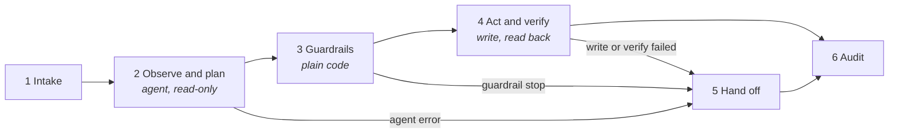

# Aelix Echo agent workflows for n8n

[](https://github.com/Aelix-Echo/aelix-agent-workflows/actions/workflows/ci.yml)


n8n workflows for the Aelix Echo agents: 45 in all.

- **Seven reference workflows**, one for each industry card on [aelixecho.com/ai-agents](https://aelixecho.com/ai-agents) (below).
- **38 product agents**, one for each agent in the Aelix Echo agent catalogue, across all seven suites. They are listed in [docs/product-agents.md](docs/product-agents.md), which is generated from the source.

Each one runs the same loop: observe, plan, act, verify, hand off.

## Reference workflows

| # | Workflow | Industry | Work taken off the desk | Trigger |
|---|---|---|---|---|
| 1 | [`01-fintech-refund-handler`](workflows/01-fintech-refund-handler.json) | FinTech | Refund handling: eligibility check and refund | Webhook |
| 2 | [`02-healthcare-prior-auth-triage`](workflows/02-healthcare-prior-auth-triage.json) | Healthcare | Prior-auth triage: packet assembly and routing | Webhook |
| 3 | [`03-manufacturing-invoice-exception`](workflows/03-manufacturing-invoice-exception.json) | Manufacturing | Invoice exceptions: match, draft, escalate | Webhook |
| 4 | [`04-logistics-shipment-exceptions`](workflows/04-logistics-shipment-exceptions.json) | Logistics | Shipment exceptions: trace, re-plan, escalate | Webhook |
| 5 | [`05-legaltech-contract-intake`](workflows/05-legaltech-contract-intake.json) | LegalTech | Contract intake: classify and route | Webhook |
| 6 | [`06-energy-outage-ticket-triage`](workflows/06-energy-outage-ticket-triage.json) + [`poller`](workflows/06-energy-outage-ticket-poller.json) | Energy & Utilities | Outage ticket triage: correlate and dispatch | Every 2 min (poller starts one run per ticket) |
| 7 | [`07-realestate-vendor-onboarding`](workflows/07-realestate-vendor-onboarding.json) | Real Estate & Construction | Vendor onboarding: document collection | Webhook |

## How every workflow is built



- **The agent only reads.** It returns a structured proposal validated against a JSON schema and cannot change a system of record.
- **Guardrails are deterministic code.** They re-read the source of truth and recompute the model's arithmetic instead of trusting it.
- **Writes are idempotent and verified** by reading the record back.
- **Every stop goes to one hand-off**, with the reasons, the proposal and the full tool-call trace, so a person can decide quickly.
- **Every run is audited**, and customers and vendors only ever receive fixed templates.

- **Product agents add a named approver.** Most pause and ask one named person in Slack before acting; some act on their own only inside a pre-approved envelope; some only produce a draft for a named reviewer. Every approval is recorded with who, what and when.
- **The audit log is tamper-evident**: append-only and hash-chained, with a verify function that names the first altered row.

More in [docs/architecture.md](docs/architecture.md), including what each workflow always leaves to a person.

## Quick start

```bash
psql "$DATABASE_URL" -f sql/schema.sql                 # 1. audit, exception and draft tables
n8n import:workflow --separate --input=workflows/       # 2. the seven reference workflows (Energy is two files)
for d in workflows/products/*/; do n8n import:workflow --separate --input="$d"; done   # 3. the product agents
```

Then connect credentials, edit each **Config** node (including the named approver or reviewer), and post a file from `samples/` or `samples/products/` to the test webhook. Full steps in [docs/setup.md](docs/setup.md).

## Repository layout

```
├── workflows/          Ready-to-import n8n workflows (generated, do not edit by hand)
│   └── products/       The 38 product agents, one folder per suite
├── src/
│   ├── lib.mjs         Shared builders: agent, guardrails, hand-off, audit, stickies
│   ├── product.mjs     Product-agent builder: approve, envelope and draft patterns
│   ├── workflows/      One source file per reference workflow
│   └── products/       One source file per product agent: prompts, tools, schema, rules, sample
├── test/
│   ├── workflows/      Offline scenarios for the reference workflows, one file per workflow
│   ├── products/       Offline scenarios for the product agents, one file per suite
│   └── e2e/            Live end-to-end suite: real n8n and Claude, mocked business systems
├── scripts/            build.mjs (source to JSON) and validate.mjs (n8n validator)
├── samples/            Example request payloads, one per workflow (products/ for the product agents)
├── sql/                Postgres schema: tamper-evident runs, exceptions, drafts, PA worklist
├── docs/               Architecture, setup and testing guides, and the product-agent catalogue
└── .github/            CI, Dependabot, PR template, code owners
```

## Quality checks

Every push runs [CI](.github/workflows/ci.yml):

| Check | What it proves |
|---|---|
| Build check | The committed JSON, samples and docs/product-agents.md are exactly what the source generates |
| Guardrail tests | 844 scenarios across all 46 workflows, on Node 22 and 24, with no network or model |
| n8n validation | Node parameters pass n8n's own schema validator; canvas layout and connections are sound |
| Secret scan | No credentials anywhere in the git history |

Run them locally with `npm run check`. See [CONTRIBUTING.md](CONTRIBUTING.md) for the development workflow.

On demand, `npm run test:e2e` runs every workflow end to end in a real n8n with real Claude, against mocked business systems, and checks each outcome and every write. It calls the Claude API (about $2 a run). See [docs/testing.md](docs/testing.md).

## Status

- **Offline:** all 46 workflows (7 reference workflows, one of them in two files, and 38 product agents) import into n8n 2.40.7 and pass its validator; every Code node compiles; the guardrail, approval, verification and hand-off logic passes 844 scenarios. The tamper-evident audit schema was exercised on a real Postgres engine (PGlite): chaining, refused updates and deletes, and tamper detection.
- **Live, with real Claude (Opus 5) in real n8n (reference workflows):** the latest full run passed 25 of 27 cases across all seven. Every success path completed with exactly one verified write, and every escalation and prompt-injection case was stopped with no write.
- **Known limitation:** in about 6% of live cases (4 of 64 across the post-fix runs), Claude's final answer fails n8n's output-format check. The workflow then escalates to a person with the error recorded and makes no write, so it fails safe, but that case needs a human that it would not otherwise have needed.
- **Not yet tested live:** the 38 product agents, Slack approvals, and the real Stripe, Salesforce and gateway APIs (the live suite uses mocks with the same contracts). Each product agent calls a gateway contract named in its Setup sticky that has to be built or mapped to the real systems. Run every workflow first with test-mode keys and staging endpoints.
- **Model:** Claude Opus 5. Opus 5.5 is not yet usable from n8n; see [docs/architecture.md](docs/architecture.md#model).

## Security

Credentials live in n8n, never in this repository. For PHI handling and how to report a vulnerability, see [SECURITY.md](SECURITY.md).
